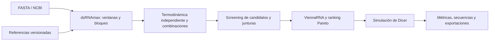

# Dicer Lab

**Diseño exploratorio de dsRNA y simulación reproducible de su procesamiento por Dicer.**

Proyecto desarrollado en el contexto de **Investigathón 2026**, donde obtuvo el
**segundo puesto**. Dicer Lab reúne búsqueda de secuencias, construcción de
candidatos multigen, análisis termodinámico y simulación en una aplicación web
con un motor científico accesible desde Python.

> Los resultados son hipótesis computacionales. El proyecto no ha demostrado
> eficacia de silenciamiento, selectividad biológica ni seguridad ambiental
> mediante validación experimental. El premio reconoce el proyecto presentado;
> no valida sus predicciones biológicas.

## Qué problema aborda

Un dsRNA quimérico combina regiones asociadas con varios genes objetivo. Su
evaluación exige distinguir qué secuencias contiene, qué coincidencias tiene
con referencias excluidas, qué estructuras predice un modelo energético y qué
productos genera un modelo de corte.

Dicer Lab permite explorar esas preguntas conservando parámetros, semillas,
coordenadas y procedencia. Estar en fase, permanecer dentro de un gen y producir
silenciamiento son propiedades distintas; la aplicación calcula las dos
primeras bajo supuestos explícitos, sin inferir la tercera.

## Flujo implementado

1. **Cargar objetivos.** Importar entre 2 y 8 registros multi-FASTA, o buscar
   registros de NCBI por organismo/término o accession. Se normaliza T→U y se
   rechazan bases ambiguas en objetivos. La búsqueda usa E-utilities, no BLAST.
2. **Elegir referencias.** Seleccionar FASTA del catálogo persistente. Se incluye
   el conjunto de transcritos anotados RefSeq de *Apis mellifera*, ensamblado
   `GCF_003254395.2`, Annotation Release 104. Los registros individuales
   importados desde NCBI se identifican como referencias parciales.
3. **Descubrir ventanas.** Un fork local de **dsRNAmax** enumera 21-mers y filtra
   coincidencias exactas con referencias seleccionadas, incluido el complemento
   inverso. Se conservan ocurrencias y procedencia.
4. **Construir candidatos.** Se puntúan ventanas con un cálculo independiente
   de vecinos próximos inspirado en convenciones de **LUCID**. El adaptador Go
   selecciona bloques; Python concatena un bloque por gen y explora combinaciones
   con semilla. Se revisan también las ventanas que cruzan junturas.
5. **Evaluar y ordenar.** **ViennaRNA 2.7.2** calcula estructuras y energías de
   ambas hebras y del dímero con Turner2004, 22 °C y sal monovalente explícita.
   El ranking Pareto combina cobertura mínima, una preferencia terminal
   exploratoria y brecha energética dimérica. Se devuelven hasta 20 candidatos.
6. **Simular con Dicer.** Transferir un candidato al motor de cortes de
   21/22/24 nt. Visualizar trayectorias, comparar poblaciones y medir fase,
   contención, cruces y remanentes. La transferencia conserva un snapshot y
   permite recuperar las secuencias de los productos simulados.
7. **Exportar.** Descargar `design-manifest.json`, `kmers.jsonl`,
   `candidates.fasta` y `ranking.csv`; las simulaciones ofrecen sus resultados
   y métricas. Los trabajos persisten y se pueden consultar o cancelar.



## Modelo de Dicer

Antes de cada propuesta se evalúa la longitud restante real `L`:

```text
P(21 | L) = 1 − epsilon(L)
P(22 | L) = epsilon(L) × p22
P(24 | L) = epsilon(L) × (1 − p22)
```

`p22` es constante por escenario. Hay políticas epsilon constante, por tramos,
lineal, cuadrática, exponencial y una expresión aritmética restringida. Cada
molécula elige un extremo de inicio; no hay dos frentes simultáneos. La regla
`stop_on_overshoot_v1` termina si una propuesta excede el sustrato restante,
sin truncarla ni volver a sortearla.

El motor incluye Monte Carlo, expectativas por programación dinámica y
contrastes con la referencia estacionaria de Fourier. Las coordenadas son
intervalos enteros semiabiertos `[start, end)`. El número ordinal de un corte
no equivale a una posición física. Consultar la
[arquitectura científica](docs/ARCHITECTURE.md) y la [guía Python](docs/USAGE.md).

## Tecnologías y organización

| Capa | Implementación |
| --- | --- |
| Interfaz | Next.js 16, React 19, TypeScript, Tailwind CSS, Recharts |
| Acceso HTTP | BFF de Next.js; FastAPI, Pydantic y Uvicorn |
| Trabajos | SQLite y archivos bajo `DATA_DIR`; un worker de cálculo separado |
| Ciencia | Python 3.13, NumPy, motor `src/dicer_sim`, ViennaRNA 2.7.2 |
| Secuencias | dsRNAmax en Go, cliente HTTP de NCBI, catálogo con SHA-256 |
| Autenticación | Modo local limitado a loopback; integración Supabase para hosting |
| Verificación | unittest, pruebas Go, Vitest, Playwright, OpenAPI y tipos generados |

```text
apps/web/                       Interfaz y BFF
services/simulator_api/          API, persistencia, worker y diseño
src/dicer_sim/                   Motor científico independiente de la web
src/fase.py                     Referencia estacionaria original
vendor/dsrnamax/                 Fuente BSD y adaptaciones del protocolo Go
contracts/                      OpenAPI y protocolo de diseño
tests/                          Pruebas científicas y del servicio
docs/                           Uso, arquitectura, ciencia y licencias
reports/dicer_demo_315/          Ejemplo sintético reproducible
notebooks/, figuras/            Exploración original; ver límites científicos
```

## Instalación y ejecución local

Requisitos: **Python 3.13**, **Node.js 24 / npm** y **Go** (verificado con
**1.24.4**). Go es necesario para diseñar secuencias; el simulador geométrico
puede utilizarse sin él. Ejecutar desde la raíz del repositorio.

```bash
git clone https://github.com/felipedurini/dicer-lab.git
cd dicer-lab
python -m venv .venv-web
```

Activar el entorno:

```powershell
# Windows PowerShell
.venv-web\Scripts\Activate.ps1
```

```bash
# Linux / macOS
source .venv-web/bin/activate
```

Instalar las dependencias en ese entorno:

```bash
python -m pip install -r requirements.txt
python -m pip install --require-hashes -r services/simulator_api/requirements.lock
npm ci --prefix apps/web
go version
```

El lock del servicio contiene hashes para los artefactos previstos de Python
3.13 en Windows/Linux; otras plataformas pueden requerir un lock específico.
No desactivar la comprobación de hashes para eludir un error de instalación.
El adaptador compila dsRNAmax automáticamente y lo guarda en la caché temporal.
También admite `DICER_GO` o un ejecutable mediante `DSRNAMAX_BINARY`.

En una terminal con el entorno Python activo:

```bash
python -m services.simulator_api
```

En otra terminal:

```bash
npm --prefix apps/web run dev
```

Abrir **http://127.0.0.1:3000**. `/design` contiene el flujo de secuencias,
`/lab` el simulador, `/compare` las comparaciones y `/runs` los trabajos.
La API escucha en `127.0.0.1:8000`. El primer arranque prepara la referencia
incluida; el FASTA expandido ocupa aproximadamente 100 MB. SQLite, importaciones,
artefactos y logs locales pertenecen a `.local/`, excluido de Git.

La configuración predeterminada permite desarrollo local sin Supabase. Los
archivos `.env.example` son plantillas: **Python no los carga automáticamente**;
exportar las variables en la terminal o configurarlas en el servicio. Next.js
admite `apps/web/.env.local`. Para consultas NCBI, configurar `NCBI_EMAIL` con
un contacto válido fuera de Git; `NCBI_API_KEY` es opcional. Las búsquedas y
accessions se envían a NCBI.

La [guía local](docs/web/LOCAL_DEVELOPMENT.md) incluye el launcher de Windows.
El [despliegue](docs/web/DEPLOYMENT.md) requiere autenticación, HTTPS y disco
persistente. Publicar el código en GitHub no configura un servicio público.

## Estado y límites

**Implementado:** carga multi-FASTA, búsqueda/importación NCBI, referencias
persistentes, screening exacto, bloques y combinaciones con semilla, cálculo
energético, ranking, transferencia al simulador, comparación y exportación.
La UI usa una longitud común de bloque; la API admite una longitud por gen.
Límites actuales: 20.000 nt de objetivos en total, constructos de hasta 1.000 nt
y hasta 100 combinaciones por trabajo.

**Pendiente:** calibración y validación experimental; equivalencia numérica
independiente con LUCID; contraste con resultados externos verificables;
pruebas de despliegue autenticado y recuperación operativa.
Consultar el [diseño de dsRNA](docs/DSRNA_DESIGN.md), la
[arquitectura web](docs/web/ARCHITECTURE.md) y el [índice de guías](docs/README.md).

- El filtro busca coincidencias **exactas de 21 nt** en las referencias elegidas.
  No evalúa mismatches, regiones semilla, expresión ni todos los organismos.
  Sin referencias seleccionadas, el diseño continúa **sin screening**.
- El transcriptoma incluido es el conjunto **anotado** de una versión de RefSeq;
  no abarca todos los transcritos posibles. Una secuencia importada no se
  convierte en un transcriptoma completo.
- Los valores termodinámicos y el peso `lambda` son convenciones exploratorias.
  El perfil combina parámetros de Zuber 2022 y Chen 2012/Biopython y simplifica
  los efectos terminales; no reproduce íntegramente ninguno de esos modelos.
  Ver [procedencia y límites del perfil](docs/RNA_NN4_PROVENANCE.md).
  Ni la estabilidad terminal ni una posición en el ranking demuestran actividad.
- El modelo de Dicer no incorpora cinética, estructura del sustrato, contexto
  celular, carga de RISC, entrega ni degradación. `epsilon(L)` no está calibrada.
- Las pruebas estadísticas contrastan implementaciones matemáticas. No son
  experimentos biológicos. Las figuras/notebooks originales tienen límites de
  interpretación detallados en `docs/ARCHITECTURE.md`, sección 2.1.
- Un único worker y SQLite limitan la concurrencia. Los trabajos de diseño
  pueden ser largos; no se garantiza un tiempo máximo de ejecución.

## Pruebas

Con Python activo y Go disponible en `PATH`:

```bash
python -B -m unittest discover -s tests -t . -v
go -C vendor/dsrnamax test ./...
python scripts/web/export_openapi.py --check
npm --prefix apps/web run test -- --run
npm --prefix apps/web run typecheck
npm --prefix apps/web run lint
npm --prefix apps/web run build
```

Para las pruebas de navegador, desde `apps/web` ejecutar
`npx playwright install chromium` y `npm run test:e2e`. Estas pruebas interceptan
respuestas HTTP: prueban la interfaz, no un despliegue real ni una consulta en
vivo a NCBI. Las integraciones Python/Go y ViennaRNA se verifican por separado.
Revisar siempre las pruebas omitidas (`skipped`).

## Licencias, créditos y fuentes

Se conserva la [licencia MIT original](LICENSE), con el crédito a **Malena Zogbi**
por el trabajo original. Las contribuciones de Dicer Lab integran el motor y
el flujo web. **La licencia MIT raíz no relicencia software ni datos de terceros.**
Consultar [THIRD_PARTY_NOTICES.md](THIRD_PARTY_NOTICES.md), el
[detalle legal y científico](docs/LICENSING.md) y el
[inventario de dependencias](docs/licenses/dependencies.csv).

- **dsRNAmax — Stephen J. Fletcher y colaboradores.** Fuente y modificaciones
  locales bajo BSD-3-Clause; revisión fijada en `vendor/dsrnamax`.
  [Artículo, 2025](https://doi.org/10.1093/nargab/lqaf064).
- **LUCID — repositorio de referencia de Brunxi.** Sus convenciones orientan un
  cálculo independiente; no se ejecuta su pipeline ni se distribuye
  `sifi21_plus`. Su licencia conflictiva no se presenta como MIT.
  [Revisión consultada](https://github.com/Brunxi/LUCID/tree/37910bd6744b2ce6ce4c9b2582819b130e7ea509).
- **Vecinos próximos.** 21 parejas de parámetros de [Zuber et al., 2022](https://doi.org/10.1093/nar/gkac261),
  CC BY 4.0; dos de Biopython 1.86 `RNA_NN3`, BSD-3-Clause, correspondientes
  a [Chen et al., 2012](https://doi.org/10.1021/bi3002709). Créditos a los autores,
  Biopython Contributors, Sebastian Bassi y Markus Piotrowski. La
  [correspondencia de las 23 entradas](docs/RNA_NN4_PROVENANCE.md) documenta
  las adaptaciones y licencias sin afirmar equivalencia con el método completo.
- **ViennaRNA — autores e Institute for Theoretical Chemistry, University of
  Vienna.** Licencia propia; [Lorenz et al., 2011](https://doi.org/10.1186/1748-7188-6-26).
- **NCBI / NLM, RefSeq y depositantes originales.** [Annotation Release 104 de
  Apis mellifera](https://www.ncbi.nlm.nih.gov/refseq/annotation_euk/Apis_mellifera/104/)
  y [política de datos](https://www.ncbi.nlm.nih.gov/home/about/policies/).
  El catálogo conserva accessions y hashes; NCBI no garantiza la ausencia de
  derechos de terceros.

Para contribuir, consultar [CONTRIBUTING.md](CONTRIBUTING.md). Para informar
un problema de seguridad, ver [SECURITY.md](SECURITY.md).
