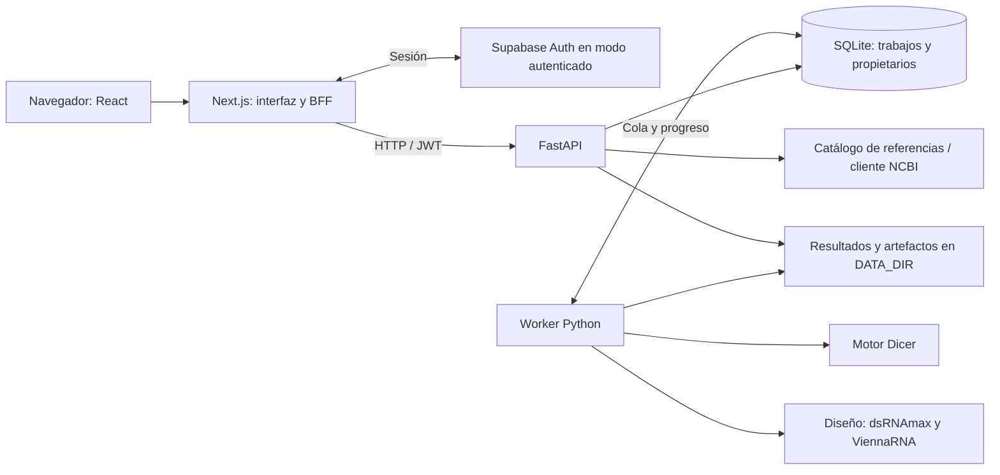

# Arquitectura web de Dicer Lab

La aplicación separa presentación, acceso HTTP, ejecución de trabajos y
cálculo científico. La instalación local se describe en
[LOCAL_DEVELOPMENT.md](LOCAL_DEVELOPMENT.md); los requisitos de una instalación
autenticada están en [DEPLOYMENT.md](DEPLOYMENT.md).

## Componentes

| Capa | Ubicación | Responsabilidad |
| --- | --- | --- |
| Interfaz | `apps/web/app/` | Diseño, simulación, comparación, trabajos, ayuda y sesión |
| BFF | `apps/web/app/api/[...path]/route.ts` | Rutas permitidas, sesión y reenvío a la API |
| HTTP | `services/simulator_api/app.py` | Contratos, límites, autorización y acceso a resultados |
| Persistencia | `storage.py` | Cola SQLite, propietarios, idempotencia y estados |
| Ejecución | `worker.py` | Reclamar trabajos y ejecutar simulaciones o diseños |
| Diseño | `services/simulator_api/design/` | Secuencias, Go, termodinámica, plegamiento y ranking |
| Ciencia | `src/dicer_sim/` | Modelo de cortes, métricas y expectativas exactas |

El navegador no ejecuta el motor científico. Las trayectorias mostradas
proceden de la API; la animación reproduce los eventos recibidos. Las bases
del modelo y sus denominadores se describen en la
[arquitectura científica](../ARCHITECTURE.md).

## Flujo de trabajos

Las solicitudes de simulación y diseño se validan con Pydantic y se guardan
con propietario, parámetros, semilla y tipo. Una clave de idempotencia permite
reintentar una solicitud sin crear otro trabajo con el mismo contenido.

El API devuelve un identificador; el cliente consulta estado y progreso.
Un proceso worker separado reclama trabajos de SQLite y escribe los resultados.
Los estados incluyen `queued`, `running`, `cancel_requested`, `cancelled`,
`succeeded` y `failed`. La cancelación es cooperativa: no equivale a terminar
instantáneamente una operación nativa de plegamiento.

SQLite, referencias y artefactos viven bajo `DATA_DIR`. Los archivos de
resultados se escriben mediante temporales y renombrado; los artefactos de
diseño se registran con nombre, tamaño y SHA-256. Los endpoints comprueban
propietario y artefacto antes de devolverlo. Los datos de ejecución no forman
parte del repositorio.

El diseño puede transferir un candidato a un trabajo de simulación. Se conserva
un snapshot de su secuencia y bloques; los cortes se calculan en el mismo motor
geométrico y después se proyectan sobre esas secuencias. Ver
[DSRNA_DESIGN.md](../DSRNA_DESIGN.md).

## Contratos

`contracts/web/v1/openapi.json` describe la API HTTP;
`apps/web/generated/api.ts` contiene los tipos derivados. El protocolo JSON
entre Python y Go está en `contracts/design/v1/protocol.schema.json`.

Después de modificar el contrato, exportarlo con
`python scripts/web/export_openapi.py` y regenerar los tipos con
`npm --prefix apps/web run generate:api`. El modo `--check` del exportador
detecta diferencias sin escribir el archivo.

Los previews son consultas de trayectoria o de epsilon; las poblaciones y los
diseños se encolan. Las exportaciones incluyen manifiestos y métricas; el flujo
de diseño también entrega FASTA, ventanas y ranking.

## Autenticación y límites de confianza

El modo local usa una identidad fija para desarrollo y exige loopback. No debe
exponerse mediante túneles ni emplearse como autenticación remota.

En modo Supabase, Next gestiona la sesión y el API verifica la firma JWT, issuer,
audience, caducidad y allowlist. La allowlist debe coincidir en ambos servicios.
Las solicitudes que modifican datos verifican Origin y los trabajos están
aislados por propietario. El cliente no puede elegir libremente rutas locales
de FASTA, artefactos o ejecutables.

El API limita el cuerpo HTTP a 64 KiB antes de validar los modelos. El BFF
restringe las rutas reenviadas. Las variables privadas, logs y bases de datos
deben permanecer fuera de Git; ver [SECURITY.md](../../SECURITY.md).

## Operación y verificación

La implementación utiliza una instancia de API y un worker, con SQLite y
filesystem persistente. No proporciona escalado horizontal, alta disponibilidad
ni una herramienta administrativa completa de backup y restauración. Un cierre
de pestaña no elimina un trabajo; un fallo del host requiere recuperación según
el estado persistido. No se garantiza un tiempo máximo de diseño.

Las pruebas Python cubren contratos, aislamiento, almacenamiento, recuperación
e integración científica; Go verifica el protocolo y sus algoritmos. Vitest
prueba componentes y Playwright prueba navegación con respuestas API simuladas.
Estas últimas no sustituyen una prueba con API, autenticación y almacenamiento
reales en el destino de despliegue.
